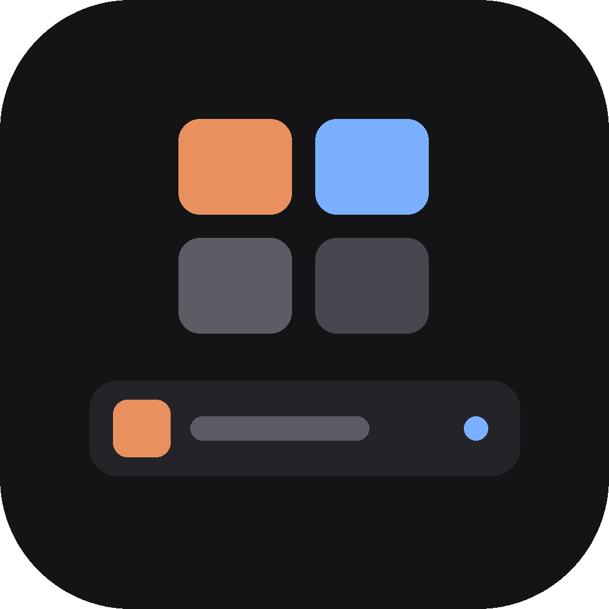
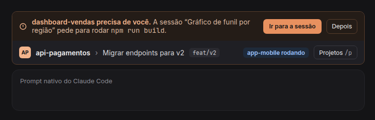
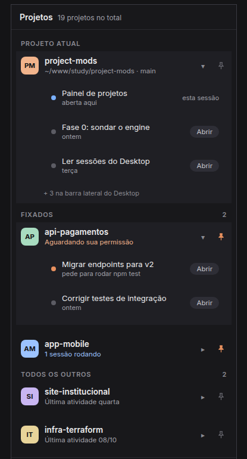
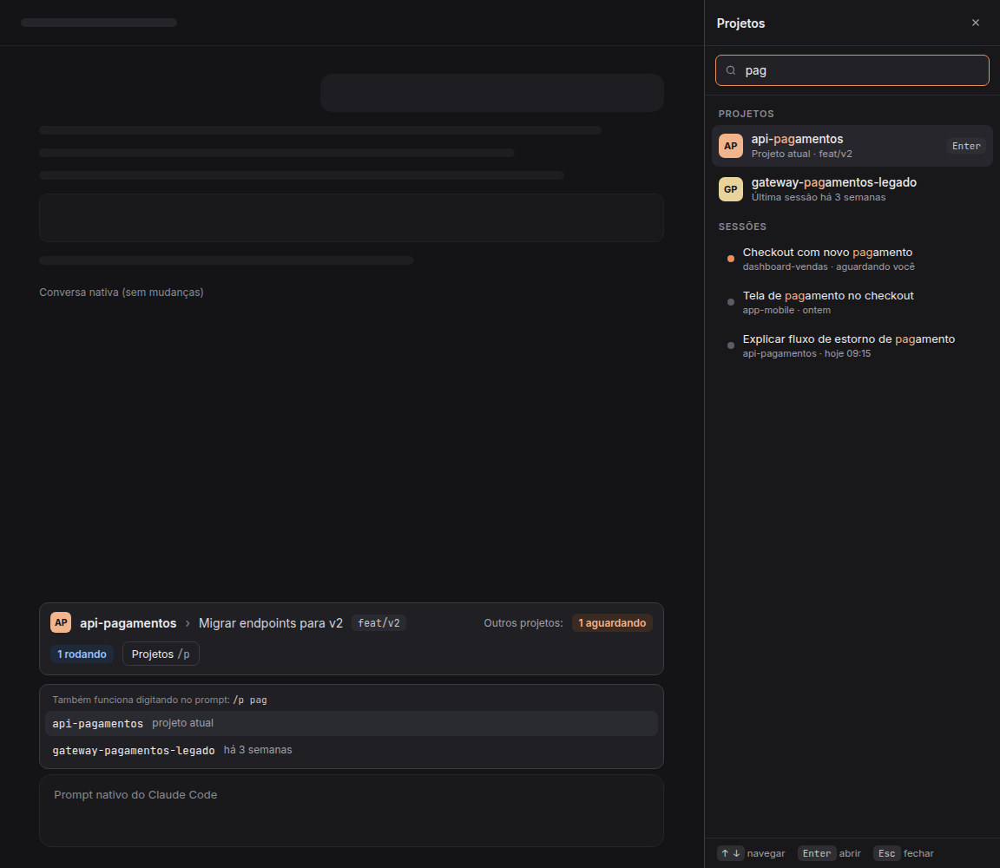
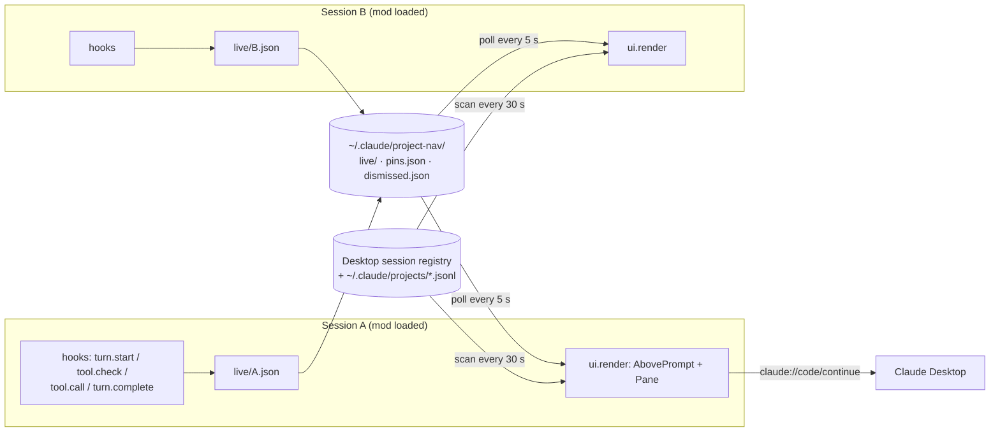

<p align="center">
  
</p>

<h1 align="center">project-nav</h1>

<p align="center">
  Project and session navigation for <a href="https://code.claude.com">Claude Code</a>: know where you are, what is running, and which session needs you — across every project at once.
</p>

<p align="center">
  <a href="https://github.com/BrunoSSantana/claude-code-project-nav/actions/workflows/ci.yml"></a>
  <a href="LICENSE"></a>
  
  
</p>

<p align="center"><a href="README.pt-BR.md">Leia em português</a></p>

---

When you run several Claude Code sessions in parallel, the Desktop sidebar mixes projects and sessions in one list. It is hard to see which session is blocked on a permission prompt, and switching context means hunting for it.

`project-nav` is a **Claude Code mod** — a plugin of TypeScript hooks that draws inside Claude Code's own UI — that adds navigation without touching the conversation, the prompt, or the native sidebar.

<p align="center">
  
</p>

## Features

- **Context band above the prompt** — project avatar and name, session title and git branch. Click the title to list the project's sessions and jump to one, or start a new session.
- **Cross-session status** — live "N waiting" / "N running" counters for your other sessions.
- **Alerts** — when another session asks for a permission or a question, the band shows the project, the session and the reason (e.g. `Bash: npm run build`), with **Go to session** and **Later**.
- **Projects pane** (`/p` or ▦) — the same projects as the Desktop sidebar, grouped into *Current project*, *Pinned* and *All others*, with status, up to 5 sessions each, search, status filters and pins.
- **Prompt search** — `/p <term>` suggests projects and sessions as you type and opens the pane already filtered.
- **Works on Desktop and in the terminal** — avatars are `Svg` on Desktop and styled text in the terminal; opening a session uses a Desktop deep link, or copies `cd <folder> && claude --resume <id>` where no deep link exists.

<table>
  <tr>
    <td width="40%"></td>
    <td></td>
  </tr>
  <tr>
    <td align="center"><sub>Projects pane: status, sessions and pins</sub></td>
    <td align="center"><sub>Search in the pane and <code>/p</code> autocomplete</sub></td>
  </tr>
</table>

<sub>Images are renders of the design mockups in <a href="docs/design/">docs/design</a>; the UI text is currently in Brazilian Portuguese.</sub>

## Install

Requires Claude Code **v2.1.287+** in the terminal or **v2.1.286+** on Desktop.

At the prompt of a terminal session:

```
/plugin install project-nav --marketplace BrunoSSantana/claude-code-project-nav
```

Answer `y` to add the marketplace, then pick a scope (user scope loads it in every session). From a shell:

```bash
claude plugin install project-nav --marketplace BrunoSSantana/claude-code-project-nav
```

In the Desktop app, where `/plugin` does not run: click **+** next to the prompt box → **Plugins** → **Add marketplace** with `BrunoSSantana/claude-code-project-nav` → **Add plugin**. A mod installed from a terminal at the user scope also loads in Desktop sessions.

## How it works



- **Status from engine events.** `turn.start` marks a session *running*; a `tool.check` that resolves to `ask` (or an `AskUserQuestion` call) marks it *waiting*, with a human-readable reason; `turn.complete` marks it *idle*. A 15 s heartbeat keeps the entry fresh, and anything silent for 60 s is treated as closed.
- **One file per session.** `$.store` is a single JSON file per plugin, so concurrent sessions writing to it would clobber each other. Each session writes its own `live/<sessionId>.json` instead and reads everyone else's.
- **Mirrors the Desktop sidebar.** Projects come from the Desktop's session registry, grouped by `originCwd || cwd` and named after the GitHub `origin` repo — the same rule the app uses — rather than from `~/.claude/projects/`, which also holds worktrees and subfolders.
- **Pure core, thin shell.** Grouping, ordering, filters, counters and alert logic live in pure functions (`src/model.ts`, `src/status.ts`); hooks and rendering only wire them to the engine.
- **Graceful fallbacks.** There is no session-switch API for mods, so switching uses the Desktop's `claude://` deep link; in the terminal, or for sessions Desktop doesn't know, the command to resume is copied to the clipboard.

The full design — requirements, the phase-0 investigation of undocumented formats, and every deviation from the original plan — is in [docs/SPEC.md](docs/SPEC.md).

## Project structure

```
.claude-plugin/   plugin manifest, marketplace entry, icon
hooks/            register.tsx — the hooks module the engine loads
src/              data reads, live status, pure model, band and pane rendering
types/            $.state contract checked by `claude plugin validate`
tests/            35 tests across model, status, band and pane (terminal + Desktop)
docs/             spec, design mockups, images and release process
```

## Development

Run the mod from your working copy with hot reload:

```bash
claude --plugin-dir ./claude-code-project-nav
```

For Desktop sessions, add the absolute path to `~/.claude/settings.json` and reopen the session:

```json
"env": {
  "CLAUDE_CODE_PLUGIN_DIRS": "/absolute/path/to/claude-code-project-nav",
  "CLAUDE_CODE_PLUGIN_DIR_WATCH": "1"
}
```

Validate and test:

```bash
claude plugin validate .
```

```bash
claude plugin test .
```

`tsconfig.json` extends `.claude-plugin/types/tsconfig.json`, which Claude Code writes the first time it loads the mod; after that, `tsc -p . --noEmit` type-checks against the engine's API.

See [CONTRIBUTING.md](CONTRIBUTING.md) to contribute and [docs/RELEASING.md](docs/RELEASING.md) for versioning and releases.

## Data and privacy

- Reads the Desktop session registry (`~/.config/Claude/claude-code-sessions/`) and the `.jsonl` transcripts under `~/.claude/projects/`. It never writes to them and never reads the OAuth token cache.
- Writes only to `~/.claude/project-nav/`: one status file per open session (`live/`), pins (`pins.json`) and dismissed alerts (`dismissed.json`).
- Nothing leaves your machine.

## Limitations

- Relies on internal Desktop formats (the session registry and the `claude://` link), which may change in an app update.
- Built and tested on Linux. Scanning uses GNU `find -printf`; opening links switches from `xdg-open` to `open` on macOS, but listing still needs GNU find there.
- Status exists only for sessions running the mod.
- UI text is in Brazilian Portuguese.
- Cloud and WSL sessions are out of scope: mods do not draw there.

## Built with Claude Code

This mod was designed and built spec-first with Claude Code itself: a written spec with numbered requirements (F1–F16), a phase-0 probe to answer what the mods API docs did not, then one phase per iteration, each closed with `claude plugin validate` and `claude plugin test`. The spec records what was verified live versus only under test.

## License

[MIT](LICENSE) © Bruno Santana
