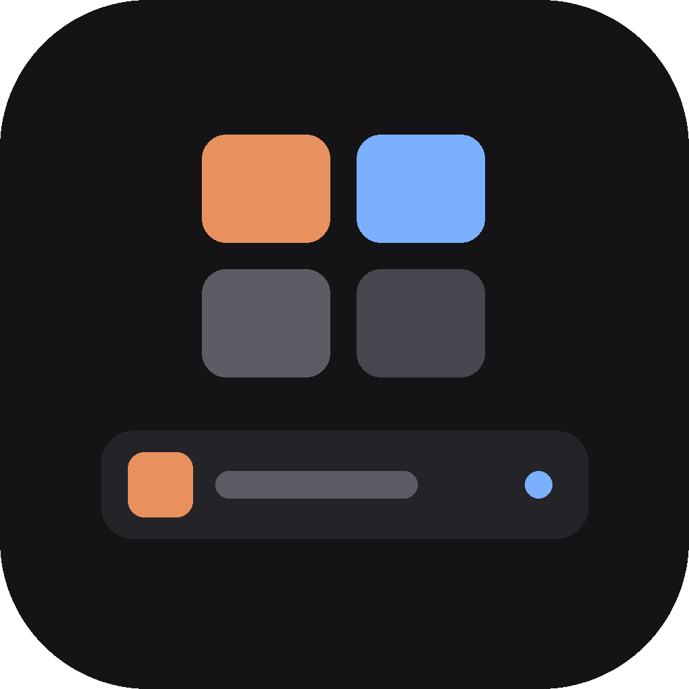
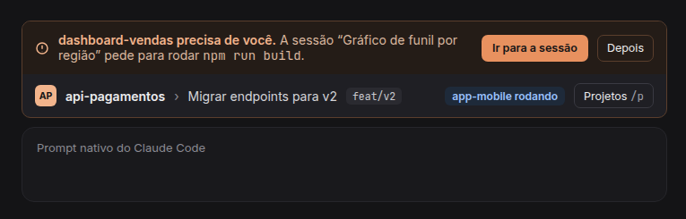
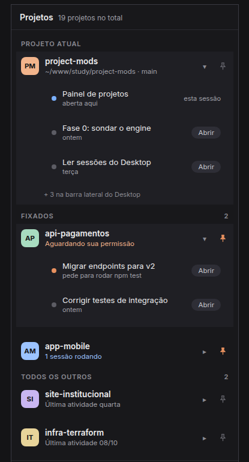
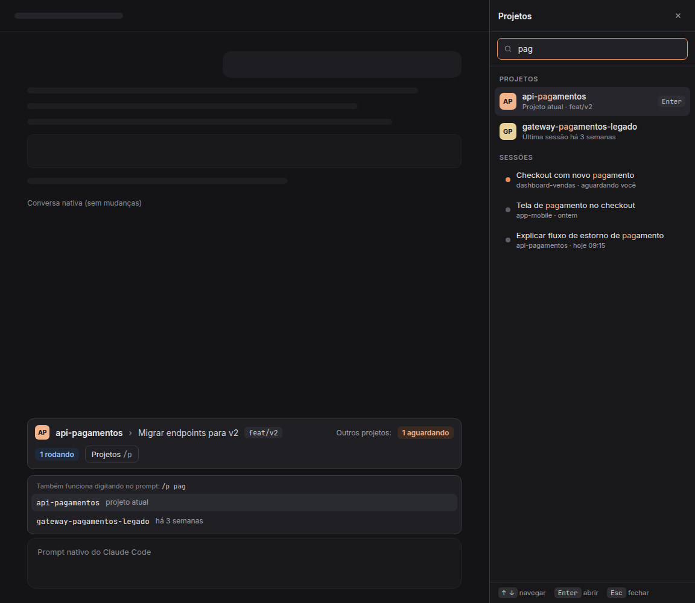
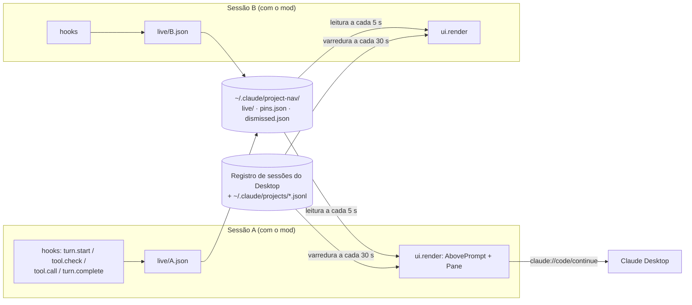

<p align="center">
  
</p>

<h1 align="center">project-nav</h1>

<p align="center">
  Navegação entre projetos e sessões no <a href="https://code.claude.com">Claude Code</a>: saiba onde você está, o que está rodando e qual sessão precisa de você, em todos os projetos ao mesmo tempo.
</p>

<p align="center">
  <a href="https://github.com/BrunoSSantana/claude-code-project-nav/actions/workflows/ci.yml"></a>
  <a href="LICENSE"></a>
  
  
</p>

<p align="center"><a href="README.md">Read in English</a></p>

---

Com várias sessões do Claude Code rodando em paralelo, a barra lateral do Desktop mistura projetos e sessões numa lista só. Fica difícil ver qual sessão está parada esperando uma permissão, e trocar de contexto vira caça.

O `project-nav` é um **mod do Claude Code** (um plugin de hooks em TypeScript que desenha dentro da própria interface do Claude Code) que acrescenta navegação sem mexer na conversa, no prompt nem na barra lateral nativa.

<p align="center">
  
</p>

## Funcionalidades

- **Faixa acima do prompt**: avatar e nome do projeto, título da sessão e branch. Clicar no título lista as sessões do projeto para trocar de sessão ou abrir uma nova.
- **Status entre sessões**: contadores "N aguardando" e "N rodando" das outras sessões, ao vivo.
- **Alertas**: quando outra sessão pede permissão ou faz uma pergunta, a faixa mostra o projeto, a sessão e o motivo (por exemplo `Bash: npm run build`), com **Ir para a sessão** e **Depois**.
- **Painel de projetos** (`/p` ou ▦): os mesmos projetos da barra lateral do Desktop, em *Fixados* (no topo), *Projeto atual* e *Todos os outros*, com status, todas as sessões em páginas de 5, "+ Nova sessão" por projeto, busca, filtros por status e alfinete para fixar.
- **Busca pelo prompt**: `/p <termo>` sugere projetos e sessões enquanto você digita e abre o painel já filtrado.
- **Desktop e terminal**: avatar em `Svg` no Desktop e texto com fundo no terminal. Abrir uma sessão usa o deep link do Desktop ou, onde ele não existe, copia `cd <pasta> && claude --resume <id>`.

<table>
  <tr>
    <td width="40%"></td>
    <td></td>
  </tr>
  <tr>
    <td align="center"><sub>Painel: status, sessões e fixados</sub></td>
    <td align="center"><sub>Busca no painel e autocomplete de <code>/p</code></sub></td>
  </tr>
</table>

<sub>As imagens são renders dos mockups de design em <a href="docs/design/">docs/design</a>.</sub>

## Instalação

Requer Claude Code **v2.1.287+** no terminal ou **v2.1.286+** no Desktop.

No prompt de uma sessão de terminal:

```
/plugin install project-nav --marketplace BrunoSSantana/claude-code-project-nav
```

Responda `y` para adicionar o marketplace e escolha o escopo (o escopo de usuário carrega o mod em todas as sessões). Pelo shell:

```bash
claude plugin install project-nav --marketplace BrunoSSantana/claude-code-project-nav
```

No app Desktop, onde `/plugin` não roda: clique em **+** ao lado da caixa do prompt → **Plugins** → **Add marketplace** com `BrunoSSantana/claude-code-project-nav` → **Add plugin**. Um mod instalado pelo terminal no escopo de usuário também carrega nas sessões do Desktop.

## Como funciona



- **Status a partir dos eventos do engine.** `turn.start` marca a sessão como *rodando*; um `tool.check` que termina em `ask` (ou uma chamada de `AskUserQuestion`) marca *aguardando*, com o motivo legível; `turn.complete` marca *parada*. Um pulso a cada 15 s mantém a entrada viva, e o que fica 60 s sem pulso conta como fechado.
- **Um arquivo por sessão.** O `$.store` é um único JSON por plugin, então sessões gravando ao mesmo tempo se sobrescreveriam. Cada sessão grava o próprio `live/<sessionId>.json` e lê os das outras.
- **Espelha a barra lateral do Desktop.** Os projetos vêm do registro de sessões do Desktop, agrupados por `originCwd || cwd` e nomeados pelo repositório `origin` do GitHub, a mesma regra do app, e não de `~/.claude/projects/`, que também guarda worktrees e subpastas.
- **Núcleo puro, casca fina.** Agrupamento, ordem, filtros, contadores e alertas são funções puras (`src/model.ts`, `src/status.ts`); hooks e desenho só ligam isso ao engine.
- **Planos B.** Mods não têm API para trocar de sessão, então a troca usa o deep link `claude://` do Desktop; no terminal, ou para sessões que o Desktop não conhece, o comando de retomar vai para a área de transferência.

O desenho completo (requisitos, a investigação da fase 0 sobre formatos não documentados e cada desvio do plano original) está em [docs/SPEC.md](docs/SPEC.md) (em inglês).

## Estrutura

```
.claude-plugin/   manifesto, entrada do marketplace, ícone
hooks/            register.tsx, o módulo de hooks que o engine carrega
src/              leitura de dados, status ao vivo, modelo puro, faixa e painel
types/            contrato do $.state, conferido pelo `claude plugin validate`
tests/            35 testes de modelo, status, faixa e painel (terminal e Desktop)
docs/             spec, mockups de design, imagens e processo de release
```

## Desenvolvimento

Rodar o mod a partir da cópia local, com recarga automática:

```bash
claude --plugin-dir ./claude-code-project-nav
```

Para sessões do Desktop, coloque o caminho absoluto no `~/.claude/settings.json` e reabra a sessão:

```json
"env": {
  "CLAUDE_CODE_PLUGIN_DIRS": "/caminho/absoluto/para/claude-code-project-nav",
  "CLAUDE_CODE_PLUGIN_DIR_WATCH": "1"
}
```

Validar e testar:

```bash
claude plugin validate .
```

```bash
claude plugin test .
```

O `tsconfig.json` estende `.claude-plugin/types/tsconfig.json`, que o Claude Code escreve na primeira vez que carrega o mod; a partir daí, `tsc -p . --noEmit` checa os tipos contra a API do engine.

Veja [CONTRIBUTING.md](CONTRIBUTING.md) para contribuir e [docs/RELEASING.md](docs/RELEASING.md) para versões e releases.

## Dados e privacidade

- Lê o registro de sessões do Desktop (`~/.config/Claude/claude-code-sessions/`) e os `.jsonl` de `~/.claude/projects/`. Nunca escreve neles nem lê o cache de tokens OAuth.
- Escreve só em `~/.claude/project-nav/`: um arquivo de status por sessão aberta (`live/`), os fixados (`pins.json`) e os alertas dispensados (`dismissed.json`).
- Nada sai da sua máquina.

## Limitações

- Usa formatos internos do Desktop (registro de sessões e link `claude://`), que podem mudar numa atualização do app.
- Feito e testado no Linux. A varredura usa `find -printf` (GNU); no macOS o link abre com `open` em vez de `xdg-open`, mas a listagem ainda depende do GNU find.
- Status só existe para sessões com o mod carregado.
- Sessões na nuvem e WSL ficam de fora: mods não desenham lá.

## Feito com o Claude Code

O mod foi desenhado e construído a partir de uma spec, com o próprio Claude Code: requisitos numerados (F1 a F16), uma fase 0 para responder o que a documentação da API de mods não fechava e uma fase por iteração, cada uma fechada com `claude plugin validate` e `claude plugin test`. A spec registra o que foi conferido ao vivo e o que foi só em teste.

## Licença

[MIT](LICENSE) © Bruno Santana
